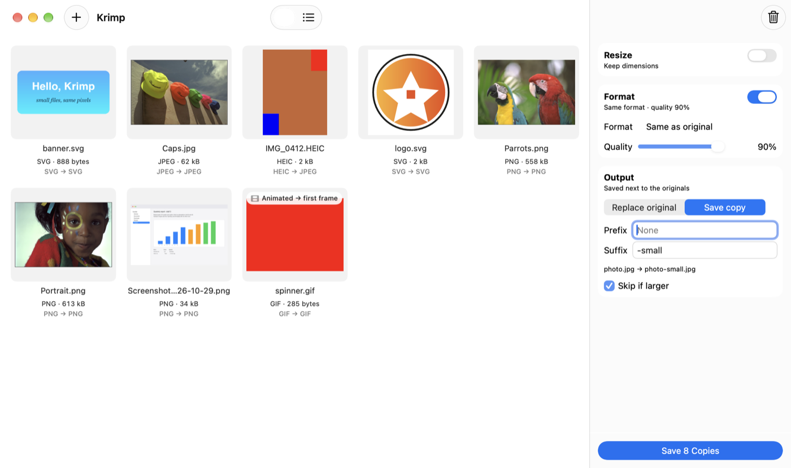
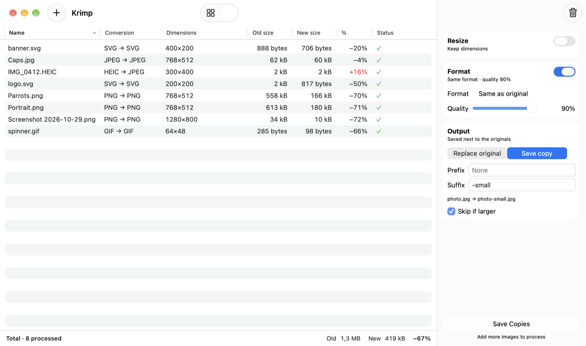

# Krimp

A tiny native macOS app that resizes and re-encodes images and minifies SVGs. Drop files in,
pick a size and an output format (or keep the original format and quality), then replace the
originals or save a copy next to each one.

- Encoders: jpegli (JPEG), imagequant + oxipng (PNG), libwebp (WebP), ravif (AVIF),
  imagequant + gif (GIF), ImageIO (TIFF). SVG: resvg for rendering, oxvg for minifying.
- Every library is compiled from source and statically linked into the one executable.
  No helper processes, no network access, no background anything.
- macOS 26 or newer, Apple silicon. The app is under 10 MB.





## Using it

- Drop images (or folders) on the window or the Dock icon, use ⌘O, or Finder's *Open With*.
- **Resize**: width, height, longest edge or percentage. Raster images are never enlarged;
  SVGs render sharp at any size.
- **Format**: *Same as original* or JPEG, PNG, WebP, AVIF, GIF, TIFF, SVG, with a quality
  slider (default 90). Turn the card off to resize only, keeping each file's format and quality.
- **Output**: *Replace original* moves the original to the Trash; *Save copy* writes
  `<prefix><name><suffix>.<ext>` next to it and never overwrites anything.
  *Skip if larger* keeps the original when re-encoding in the same format doesn't help.
- All metadata (EXIF, GPS, XMP, IPTC, ICC) is stripped after applying orientation and
  converting to sRGB. SVG minification is checked against a render of the original and
  skipped if anything would change visually.

## Building

Build machine requirements (none are needed at runtime):

- Xcode 26 or newer
- Rust via [rustup](https://rustup.rs) with the `aarch64-apple-darwin` target
- `cmake` (builds jpegli), `xcodegen`, `cbindgen`

```sh
make bootstrap   # checks/installs the tools above and fetches the jpegli submodule
make             # builds build/DerivedData/Build/Products/Release/Krimp.app
make test        # cargo tests + Swift Testing suite
make fixtures    # optional: downloads a 10 MB CC0 DNG sample for the camera RAW test
make size        # app size table (needs cargo-bloat)
make notices     # regenerates THIRD_PARTY_NOTICES.md and the About panel credits
```

The Xcode project is generated from `project.yml` (`make project`) and is not checked in.
Builds are ad-hoc signed with Hardened Runtime. To sign with your own certificate, create a
git-ignored `Local.xcconfig` next to `project.yml`:

```
DEVELOPMENT_TEAM = ABCDE12345
CODE_SIGN_IDENTITY = Apple Development
```

## Licence

GPL-3.0-or-later; see `LICENSE`. This is required because the app statically links
libimagequant, which is GPL-3.0-or-later. Bundled libraries and their licences are listed in
`THIRD_PARTY_NOTICES.md`.
